# GeoSpaX 2.0.0 — Multi-Domain Geospatial Analysis GIS

  

> **GeoSpaX** is a free and open-source GIS for applied environmental and
> geospatial analysis: a cloud-native map workspace with **1,000+ in-browser
> geoprocessing tools** plus **twelve GSX domain workbenches** — agriculture,
> biodiversity, climate, conservation, disaster, environment, forestry,
> geoscience, hydrology, land cover, marine and soil. It runs in the browser,
> on the desktop and in Jupyter, and keeps your data local and private.
> Lineage: `jm0535/map-kit` v1.4.3 → GeoSpaX 2.0 platform rewrite, built on the
> open-source [GeoLibre](https://github.com/opengeos/GeoLibre) platform (MIT).

- **[Launch GeoSpaX Web](https://geospax.in4metrix.dev/)** — the full app in your browser, nothing to install
- **[Get GeoSpaX](https://jm0535.github.io/GeoSpaX/downloads/)** — web app, desktop installers built from source, and the Python package
- **[GSX workbench guides](docs/user-guide/gsx-plugins/index.md)** — what each domain workbench does and how to use it
- **[Species distribution modelling](docs/user-guide/gsx-plugins/species-distribution-modelling.md)** — occurrences → CHELSA / Copernicus covariates → SDM → spatial cross-validation → suitability raster
- **[Getting started](https://jm0535.github.io/GeoSpaX/getting-started/)** — use GeoSpaX, run it from source, and configure it
- **[Features](https://jm0535.github.io/GeoSpaX/features/)** — the complete feature list

## GeoSpaX — what's new in 2.0.0

> **Lineage:** `jm0535/map-kit` **v1.4.3** (Leaflet, 22k-line `index.html`, FR422 habitat-assessment at PNG University of Technology) → **GeoSpaX v2.0.0** platform rewrite on GeoLibre. `map-kit` remains live at `geospax.in4metrix.dev`; v2 is the forward path.

GeoSpaX keeps **1,000+ GeoLibre WebAssembly tools** and adds a domain-analysis layer as **twelve bundled GSX workbenches** (`public/plugins/<id>/`, no upstream file edited — `docs/plugin-api.md` §Bundled plugins). Workbenches are opt-in: activate the ones you want under **Plugins → Manage Plugins**. Every workbench ships with a [detailed user guide](docs/user-guide/gsx-plugins/index.md) and a built-in **How to cite** section (APA + BibTeX) so results are citable:

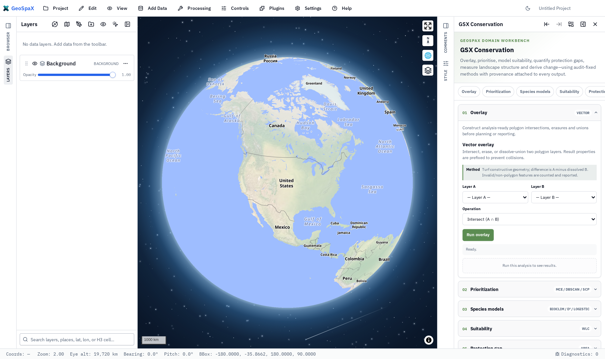

<strong>Screenshots — all twelve GSX workbenches</strong> (click to expand)

| | | |
|---|---|---|
| 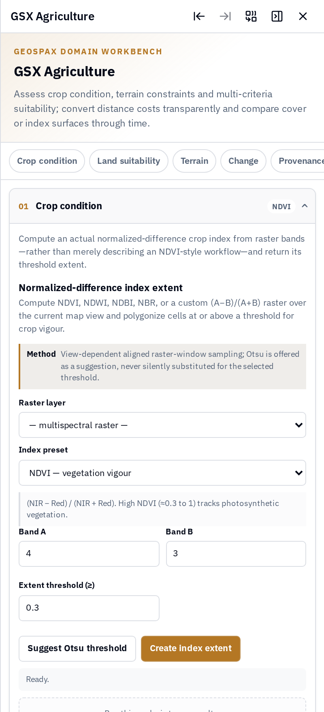 **GSX Agriculture** | 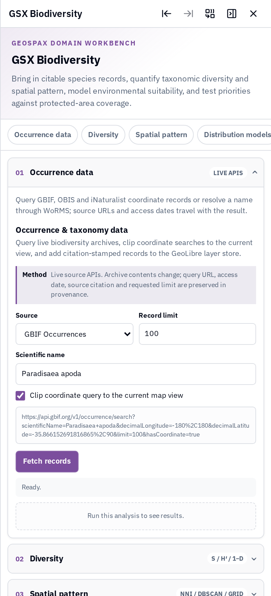 **GSX Biodiversity** | 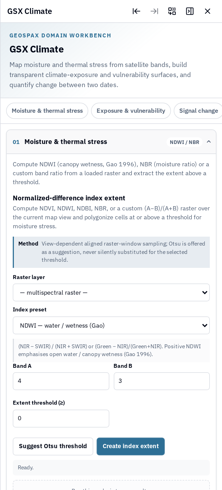 **GSX Climate** |
| 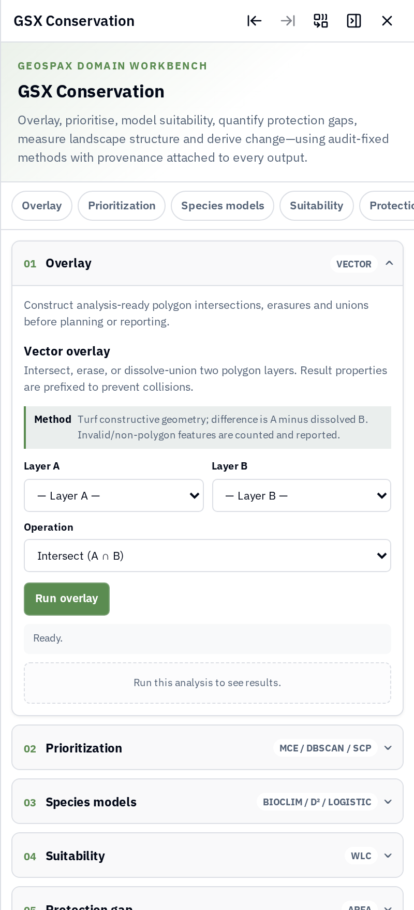 **GSX Conservation** | 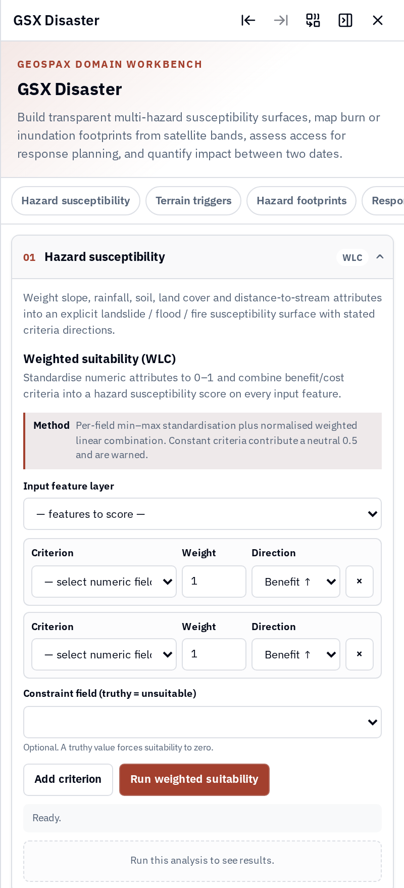 **GSX Disaster** | 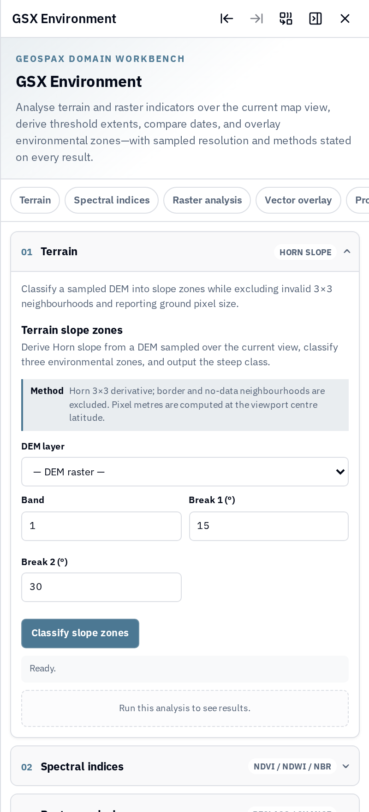 **GSX Environment** |
| 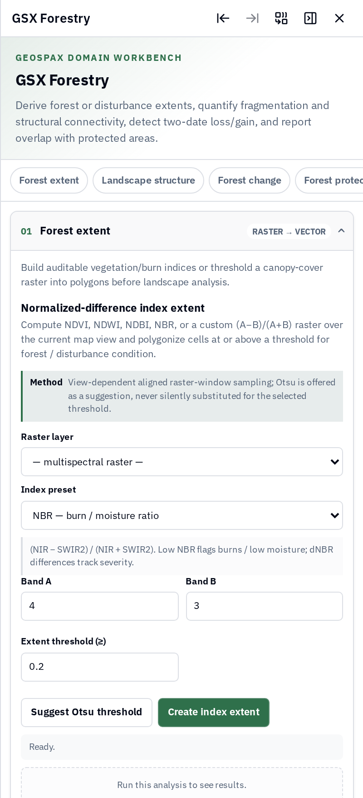 **GSX Forestry** | 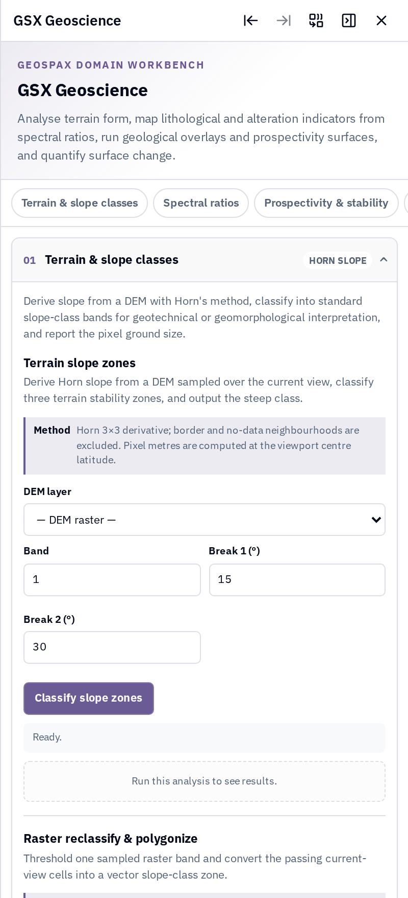 **GSX Geoscience** | 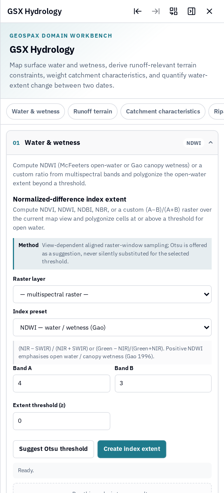 **GSX Hydrology** |
| 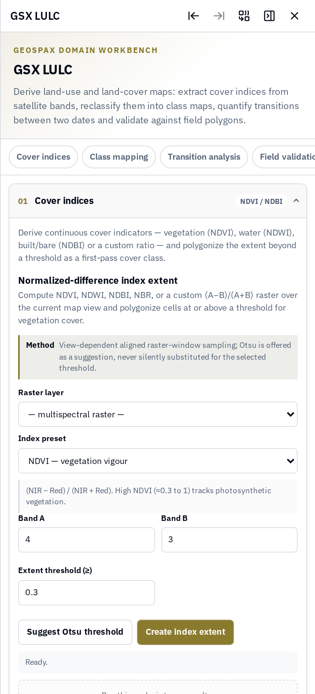 **GSX LULC** | 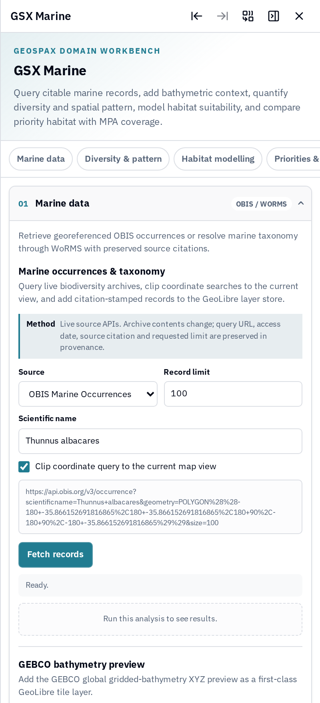 **GSX Marine** | 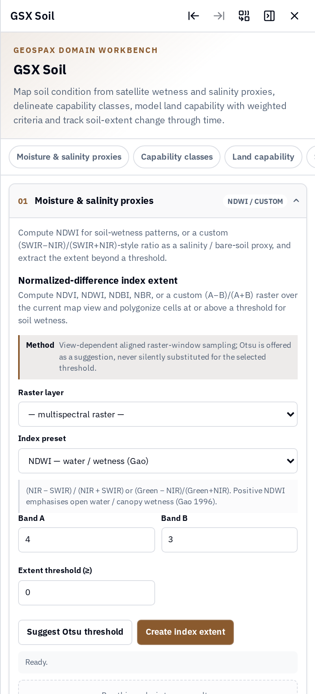 **GSX Soil** |

| Workbench | v2.0.0 contents |
|---|---|
| `geospax-conservation` | Full workbench: overlay, weighted priorities, haversine DBSCAN, unprotected sites, bounded exact/greedy SCP, BIOCLIM/Mahalanobis/explicit presence-background prediction, WLC, protection gaps, fragmentation/core metrics, connectivity, vector change, raster polygonization and provenance export |
| `geospax-environment` | Horn slope zones; NDVI/NDWI/NDBI/NBR/custom extents; Otsu-assisted raster reclassification; aligned raster change; vector overlay |
| `geospax-biodiversity` | Citable GBIF/OBIS/iNaturalist/WoRMS queries; richness/Shannon/Simpson/evenness; nearest-neighbour pattern, DBSCAN and weighted grid; SDM; priorities and protection gaps |
| `geospax-forestry` | Forest/index extent; complete fragmentation/core and connectivity reports; raster and polygon loss/gain change; protection gaps |
| `geospax-marine` | Citable OBIS/WoRMS queries and GEBCO context; diversity/nearest-neighbour/DBSCAN patterns; SDM; NDWI/custom habitat extent; weighted priorities and MPA gaps |
| `geospax-agriculture` | NDVI-family crop condition; raster reclassification; WLC and exponential distance decay; Horn slope; raster/vector crop change |
| `geospax-climate` | NDWI/NBR moisture and thermal stress extents; WLC climate-vulnerability surfaces; distance decay; raster/vector signal change |
| `geospax-disaster` | WLC multi-hazard susceptibility; Horn slope triggers; NBR/NDWI hazard footprints; response-access decay; priority sites; impact change and hotspot grids |
| `geospax-geoscience` | Horn slope classes; NDBI/custom spectral-ratio lithology proxies; WLC prospectivity; geological overlays; surface change |
| `geospax-hydrology` | NDWI open-water and wetness extents; runoff terrain; WLC catchment characteristics; riparian distance decay; water-extent change |
| `geospax-lulc` | Land-use and land-cover mapping: NDVI/NDWI/NDBI cover indices; class reclassification; two-date transition analysis; field-validation overlays; WLC allocation |
| `geospax-soil` | NDWI/custom moisture and salinity proxies; capability classes; WLC land capability; management-access decay; survey overlays |

**Analysis core `@geospax/analysis` v2.0.0** (dependency-light, pure functions, provenance-stamped; ported and checked against `js/geospax-conservation*.js`, `geospax-sdm-fix.js`, and `geospax-raster.js`):

`gap` · `geometry` · `overlay` · `planning` · `spatial` (descriptive grids plus bounded haversine DBSCAN) · `provenance` · `units` · `terrain` · `raster` · `sdm` (BIOCLIM, Mahalanobis and class-balanced presence-background logistic fit **and prediction**; the logistic option is explicitly not elapid/true MaxEnt) · `suitability` · `fragmentation` · `connectivity` · `statistics` · `change` · `hydrology` · `biodiversity` · `indices` · `classification` · `scp` (bounded exact branch-and-bound; explicitly labelled greedy fallback). GeoSpaX does not claim HiGHS-WASM execution.

**Data `@geospax/data` v2.0.0** (10 citation-carrying tiers: 5 live `CONNECTORS` + 5 `CATALOGUE_TIERS` = `ALL_SOURCES` 10):

- Live: GBIF, OBIS, iNaturalist, WoRMS, World Bank — `gbifSearchUrl`/`fetchGbifOccurrences` etc, `citationString`
- Catalogue: GEBCO, WWF ecoregions, Hansen/GFW forest, Allen Coral marine, SPREP Pacific

Build drop-ins: `npm run build -w @geospax/plugins` → `apps/geolibre-desktop/public/plugins/<id>/` (`plugin.json` + `dist/`). Typecheck: `npx tsc --noEmit -p packages/geospax-*/tsconfig.json` — zero errors in geospax sources (upstream `WorkerGlobalScope` is pre-existing).

**v1 parity formally superseded:**

| v1 bundle | Now lives in | Status |
|---|---|---|
| `geospax-conservation.js` | analysis core + Conservation §1–6 | superseded |
| `geospax-conservation-m2.js` | raster pipeline + Conservation §8 | superseded |
| `geospax-sdm-fix.js` | `sdm.ts` + Conservation §7 | superseded |
| `geospax-raster.js` | `raster.ts` + Conservation/Environment panels | superseded |

## Platform features

GeoSpaX includes everything in the GeoLibre platform it is built on: four
rendering engines (MapLibre, Mapbox, Cesium, ArcGIS), 1,000+ WebAssembly
geoprocessing tools, DuckDB Spatial SQL, 3D and planetary maps, story maps,
plugins and more. See [Features](https://jm0535.github.io/GeoSpaX/features/)
and [Demos](https://jm0535.github.io/GeoSpaX/demos/).

## Documentation

The User Guide, GSX workbench guides and tutorials are published at
**[jm0535.github.io/GeoSpaX](https://jm0535.github.io/GeoSpaX/)**.

- **Reference:** [Architecture](docs/architecture.md) ·
  [Project format](docs/project-format.md) · [Plugin API](docs/plugin-api.md) ·
  [Python package](docs/python.md) · [Internationalization](docs/i18n.md) ·
  [Maintenance & upstream sync](docs/maintenance.md#upstream-sync-and-rebranding) ·
  [Contributing](docs/contributing.md) · [How to cite](docs/citation.md)

Contributions are welcome — see [Contributing](docs/contributing.md).

## Built on GeoLibre

GeoSpaX is an independent application built on the open-source
[GeoLibre](https://github.com/opengeos/GeoLibre) platform by Qiusheng Wu and
the OpenGeos community (MIT License), and it continues to take GeoLibre's
updates. GeoSpaX is not affiliated with or endorsed by the GeoLibre project.
Some online services GeoSpaX uses — basemap tiles, map assets, sample datasets,
the plugin registry and project sharing — are run by GeoLibre under its own
[privacy policy](https://geolibre.app/privacy/) and
[terms](https://geolibre.app/terms/). If the platform is useful to you,
consider [supporting GeoLibre](https://github.com/sponsors/giswqs).

GeoLibre in turn builds on MapLibre GL JS, deck.gl, DuckDB-WASM Spatial,
Turf.js, Tauri, React and many more; see [Acknowledgements](docs/acknowledgements.md).

## Citation — GeoSpaX + GeoLibre

If you use GeoSpaX in your work, cite **GeoSpaX** and, when the platform
contributes, **GeoLibre**. `CITATION.cff` powers GitHub's **"Cite this
repository"** button.

> Moses, J. (2026). GeoSpaX 2.0.0 — Multi-domain geospatial analysis GIS
> (FR422, PNG University of Technology) [Computer software].
> <https://github.com/jm0535/GeoSpaX>

> Wu, Q. (2026). GeoLibre: A lightweight, cloud-native GIS platform for
> visualizing, exploring, and analyzing geospatial data. Zenodo.
> <https://doi.org/10.5281/zenodo.20785400>

See [How to cite](docs/citation.md) for BibTeX and APA.

## License

[MIT](LICENSE)
