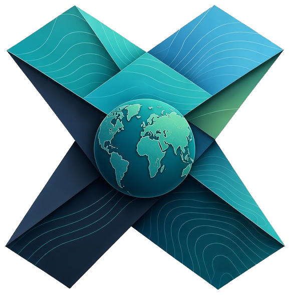

<section class="hero">
  <div class="hero__content">
    <p class="eyebrow">Multi-domain geospatial analysis GIS</p>
    
    <h1>A free and open-source GIS for applied environmental and geospatial analysis.</h1>
    <p class="hero__lead">
      GeoSpaX pairs a cloud-native map workspace with twelve GSX domain
      workbenches — agriculture, biodiversity, climate, conservation, disaster,
      environment, forestry, geoscience, hydrology, land cover, marine and
      soil — in the web browser, on the desktop, and inside Jupyter notebooks,
      while keeping your data local and private. It is built on the
      open-source GeoLibre platform (Tauri, React, MapLibre GL JS,
      DuckDB-WASM Spatial and deck.gl).
    </p>
    <div class="hero__actions">
      <a class="md-button md-button--primary" href="https://geospax.fly.dev/">Launch GeoSpaX Web</a>
      <a class="md-button" href="getting-started/">Get started</a>
      <a class="md-button" href="user-guide/interface/">User guide</a>
      <a class="md-button" href="downloads/">Download app</a>
    </div>
  </div>
  <div class="hero__media">
    <figure>
      <a href="https://share.geolibre.app/giswqs/3d-tiles" title="Open the 3D Tiles map">
        
      </a>
    </figure>
    <figure>
      <a href="https://share.geolibre.app/giswqs/nyc-buildings-and-subways" title="Open the New York City buildings and subways map">
        
      </a>
    </figure>
  </div>
</section>

## What GeoSpaX does today

<div class="feature-grid" markdown>

<div class="feature-card" markdown>
### MapLibre map workspace

Pan, zoom, rotate, and tilt a MapLibre map with OpenFreeMap basemaps or a blank background. Toggle controls for navigation, globe, terrain, geolocation, scale, attribution, and logo, plus on-map tools like Measure, Bookmark, Minimap, View State, and Field Collection for capturing point, line, and polygon observations with a custom form by GPS or map tap.
</div>

<div class="feature-card" markdown>
### Local and remote data

Load local and remote vector and raster data, then inspect and edit attributes in a table with a field calculator, charts, statistics, and export to GeoJSON, GeoParquet, Shapefile, GeoPackage, or CSV. Style layers with categorized, graduated, expression, heatmap, and clustering renderers, group and reorder the layer stack with undo/redo, and save or share `.geolibre.json` projects.
</div>

<div class="feature-card" markdown>
### Twelve GSX domain workbenches

GeoSpaX adds twelve opt-in analysis workbenches on top of the platform — **GSX Agriculture, Biodiversity, Climate, Conservation, Disaster, Environment, Forestry, Geoscience, Hydrology, LULC, Marine and Soil** — each a right-side panel with validated tools, provenance exports and a built-in How-to-Cite section. Activate the ones you need under Plugins → Manage Plugins, then follow the [GSX plugin guides](user-guide/gsx-plugins/index.md).
</div>

<div class="feature-card" markdown>
### Plugins and marketplace

Activate built-in plugins for layer control, basemaps, MapLibre components, swipe, street view, time slider, Overture Maps, LiDAR, GeoAgent, GeoEditor, and atmosphere effects, and install, update, or remove external plugins from the built-in marketplace.
</div>

<div class="feature-card" markdown>
### Advanced layer formats

Add Data covers XYZ, WMS, WFS, WMTS, ArcGIS, and STAC services; GeoParquet, FlatGeobuf, PMTiles, Zarr, and OpenStreetMap PBF; COG, GeoTIFF, Cloud-Optimized NetCDF/HDF, and MBTiles rasters; LiDAR, Gaussian splats, 3D Tiles (including authenticated tilesets), georeferenced video, and deck.gl layers; and DuckDB and PostgreSQL databases.
</div>

<div class="feature-card" markdown>
### 1,000+ geoprocessing tools

Run **1,000+ geoprocessing tools** — vector, raster, remote sensing, hydrology, terrain, LiDAR, conversion, network, and projection — from the Whitebox toolbox, browsable by category in the Processing menu. They execute in the browser on a WebAssembly runtime with raster and vector I/O, so there is no Python sidecar to install and the full set works on the web, desktop, and Android.
</div>

<div class="feature-card" markdown>
### SQL Workspace

Run DuckDB Spatial SQL in the browser against loaded layers, local files, and remote URLs, or query with the in-browser PostGIS (PGlite) and Apache Sedona engines. Bare URLs auto-wrap into the matching reader and stream over HTTP range requests. Includes sample queries, query history, and adding results to the map or exporting them as CSV or GeoParquet.
</div>

<div class="feature-card" markdown>
### Vector tools

Geometry tools under Processing → GeoSpaX Toolbox → Vector — buffer, centroids, convex hull, dissolve, bounding box, simplify, smooth, regular grid, clip, overlay (intersect/difference/union), spatial and attribute joins, selection, Voronoi/Delaunay, and H3 grids and binning — run in the browser with Turf.js, with an optional GeoPandas sidecar engine. A Spatial Statistics toolbox and a batch runner with model/pipeline chaining round out Processing.
</div>

<div class="feature-card" markdown>
### Raster tools

Raster tools under Processing → GeoSpaX Toolbox → Raster — hillshade, slope, aspect, reproject, resample, clip, polygonize, contour, zonal and focal statistics, raster calculator, reclassify, mosaic, and a Spectral Index toolbox (NDVI, NDWI, EVI with band presets) — run on a rasterio sidecar with a client-side fallback. Includes a Georeferencer and single-band or RGB raster styling.
</div>

<div class="feature-card" markdown>
### Python and Jupyter

Embed the full GeoSpaX app in a Jupyter notebook with the [`geospax`](python.md) Python package, driving the map through an expanded leafmap-style API that syncs both ways so UI edits read back from Python. An in-app Python Console scripts the app, and a docked [Notebook panel](notebook.md) runs Jupyter beside the map — JupyterLite on the web, a JupyterLab server on desktop.
</div>

<div class="feature-card" markdown>
### AI Assistant

Chat with your data: a natural-language [assistant](user-guide/ai-assistant.md) that turns plain-English requests into GeoSpaX operations — Spatial SQL, symbology, add or remove data, and map control — applied through the app so they stay auditable and undoable. Provider-pluggable (Google Gemini, Anthropic, OpenAI) with your own API key, disabled until configured.
</div>

<div class="feature-card" markdown>
### Collaboration and story maps

Edit the same project with others in real time ([collaboration](collaboration.md) MVP; requires `VITE_GEOLIBRE_COLLAB_URL`), and build scroll-driven [story maps](user-guide/storymaps.md) with a presenter view and a standalone HTML export you can publish anywhere.
</div>

</div>

## Learn GeoSpaX

New to GeoSpaX? Start with the [User Guide](user-guide/interface.md) for a feature-by-feature tour of the workspace, menus, panels, and tools, then follow the [Tutorials](tutorials/index.md) for hands-on, end-to-end workflows.

- [Interface Overview](user-guide/interface.md): the toolbar, panels, map, and status bar.
- [Adding Data](user-guide/adding-data.md): every file, web service, cloud, 3D, and database source.
- [Processing Tools](user-guide/processing.md) and [SQL Workspace](user-guide/sql-workspace.md): analysis with vector, raster, conversion, Whitebox, and DuckDB Spatial SQL.
- [AI Assistant](user-guide/ai-assistant.md): chat with your data — natural language to SQL, symbology, and map control.
- [Plugins & Marketplace](user-guide/plugins.md): activate built-ins and install from the registry.
- [Your First Map](tutorials/first-map.md): add a layer, style it, inspect it, and share it.

[Read the User Guide](user-guide/interface.md){ .md-button .md-button--primary }
[Browse the Tutorials](tutorials/index.md){ .md-button }

## GeoSpaX on the web

GeoSpaX Web is the full browser version of the GeoSpaX app, ready to use with nothing to install. It is great for exploring the map, loading browser-selected vector data supported by DuckDB-WASM Spatial, adding URL-based layers, styling layers, and testing plugins. Desktop-only file dialogs, local MBTiles, local raster reads, and filesystem save/open operations still require the installed Tauri app.

!!! note "Hosted on GitHub Pages, private by design"
    GeoSpaX Web is a static site deployed on GitHub Pages and runs entirely in your browser. There is no server account, and the data you load is processed client-side in your browser session. Data leaves your browser only when you choose to add a remote URL or explicitly share a project. The hosted site measures page visits with Google Analytics, which never sees the data you load (see the [GeoLibre Privacy Policy](https://geolibre.app/privacy/#website-analytics)). A build you host yourself has no analytics at all.

    If your data cannot be public at all, run the same web build on your own server next to your data. See [Self-Hosting & Private Data](self-hosting.md).

Open a project by passing a public `.geolibre.json` URL with the `url` query parameter:

```text
https://geospax.fly.dev/?url=https://share.geolibre.app/giswqs/3d-tiles.geolibre.json
```

You can also open hosted data directly. `data` accepts GeoJSON, GeoParquet, PMTiles, REST endpoints returning GeoJSON or ZIP, ZIP archives containing multiple GeoJSON files, and COGs. Add `style` to apply hosted vector or raster symbology:

```text
https://geospax.fly.dev/?data=https://assets.geolibre.app/data/places.geojson&style=https://assets.geolibre.app/data/sample.style.json
```

Vector layers can produce a compatible file from **Layer actions → Styles → Export GeoSpaX URL style**, and apply it again with **Import style from file (GeoSpaX URL / Mapbox GL / SLD / QML)…**, or with **Import style from text…** by pasting the style itself.

For narrow embeds, add `?layout=compact` to the demo URL to use icon-only toolbar buttons and hide project metadata:

```text
https://geospax.fly.dev/?url=https://share.geolibre.app/giswqs/3d-tiles.geolibre.json&layout=compact
```

For map-focused embeds, add `&panels=none` to hide the Layers, Style, and Attribute table panels:

```text
https://geospax.fly.dev/?url=https://share.geolibre.app/giswqs/3d-tiles.geolibre.json&layout=compact&panels=none
```

Use `toolbar=icons` when you only want icon-only toolbar buttons, or `toolbar=none` to hide the top toolbar while retaining panels and the status bar. `panels=hidden`, `panels=hide`, `panels=off`, and `hidePanels=true` are accepted aliases for hiding panels.

Use `panels=collapsed` to keep the Layers and Style icon rails visible while
starting both panels collapsed.

For a fully chrome-free, map-only embed, add `&maponly` to hide the toolbar menu, all panels, and the status bar:

```text
https://geospax.fly.dev/?url=https://share.geolibre.app/giswqs/3d-tiles.geolibre.json&maponly
```

For a read-only embed that viewers can still explore, use `&layout=viewer`. It keeps the Layers list, View and Controls menus, basemaps, and search/identify, and hides everything that would change the project:

```text
https://geospax.fly.dev/?url=https://share.geolibre.app/giswqs/3d-tiles.geolibre.json&layout=viewer
```

Other parameters control the toolbar, panels, and theme. See [Embedding & Sharing](user-guide/embedding.md) for the full parameter reference and `<iframe>` examples.

[Launch GeoSpaX Web](https://geospax.fly.dev/){ .md-button .md-button--primary }
[Embedding & Sharing](user-guide/embedding.md){ .md-button }

## Project status

GeoSpaX is **stable and in active development**, with regular releases on
[GitHub](https://github.com/jm0535/GeoSpaX/releases). For the complete,
current inventory see [Features](features.md); for how GeoSpaX compares to
QGIS, ArcGIS, CARTO, Felt, kepler.gl, and Google Earth, see the
[Comparison](comparison.md); and for the release history, see the
[GitHub releases](https://github.com/jm0535/GeoSpaX/releases).

### What ships today

- **Core workspace** — the map workspace, the `.geolibre.json` project format with Save, Open, and Share, the plugin API, and the plugin marketplace for installing, updating, and removing external plugins.
- **Data** — browser vector import, DuckDB-WASM Spatial loading, the full Add Data surface (files, web services, cloud formats, 3D layers, and databases), and cloud integrations through the Planetary Computer and Earth Engine panels, the Overture Maps plugin, and the federal Web Services plugins.
- **Processing** — the Whitebox toolbox of **1,000+ geoprocessing tools** running in the browser on WebAssembly, vector tools (Turf.js with an optional GeoPandas sidecar), raster tools (rasterio sidecar with a client-side fallback), a Spectral Index toolbox, a Raster Georeferencer, a Spatial Statistics toolbox, network analysis (isochrones, service areas, OD cost matrices), the Conversion menu (GeoParquet, FlatGeobuf, PMTiles, COG), and AI Segmentation via SamGeo/SAM 3.
- **SQL and scripting** — the SQL Workspace for DuckDB Spatial SQL (with PGlite PostGIS and Apache Sedona engines), a docked Notebook panel running Jupyter beside the map (JupyterLite on the web, a JupyterLab server on desktop), a natural-language AI assistant, and an in-app Python Console.
- **Field and collaboration** — a Field Collection tool for point, line, and polygon observations, real-time multi-user collaboration, and a scroll-driven story map builder.
- **Map surface** — multi-provider geocoding, the Time Slider plugin, a Controls menu (Measure, Bookmark, Minimap, View State), Layout settings, runtime environment variables, and diagnostics.
- **[Four rendering engines](user-guide/rendering-engines.md)** — MapLibre GL JS by default, plus Mapbox GL JS, CesiumJS, and the ArcGIS Maps SDK for JavaScript. Any engine can draw the primary map or an individual split pane, and the same project state follows each switch.
- **3D and planetary** — native Cesium globes and ArcGIS 3D scenes, globe projections in MapLibre and Mapbox, a multi-map grid of synchronized views, a free-flight camera, and planetary mapping for the Moon, Mars, Mercury, Venus, the Galilean moons, Titan, Pluto, and Charon, with a per-project ellipsoid driving measurements.
- **Styling and labeling** — a rule-based renderer with per-rule symbol properties and scale-dependent visibility, a Style Manager preset library, diagram symbology, an auto-generated on-map Legend, a shared Expression Builder driving data-defined labeling and Select by Expression, and symbology interchange as OGC SLD, QGIS QML, Mapbox GL, and GeoSpaX URL style JSON.
- **Attribute depth** — virtual fields, persistent attribute joins, an attribute form designer, a Raster Attribute Table, and editable source layers that write vector edits back to GeoPackage, GeoJSON, and PostGIS.
- **Catalog browsers** — a QGIS-style Browser panel (Data Source Manager) plus panels for STAC, NASA Earthdata, Hugging Face, GeoLens, Natural Earth, Source Cooperative, ArcGIS Hub, Socrata, and CKAN.
- **Media and capture** — map recording to video, route animation with a track-follow camera, a Camera Tour recorder, a Print Layout composer with Atlas / map series, in-browser ONNX/YOLO object detection, and a native-resolution geotagged photo viewer.
- **Distribution** — the GeoSpaX web app, desktop installers for Windows, macOS and Linux built from source (`npm run tauri:build`), Docker for the browser app, the `geospax` Python package for Jupyter, embed-friendly URL parameters including `maponly`, a versioned `postMessage` API and the typed `@geolibre/embed` client for host pages, and offline support (Download Offline Area plus service-worker caching of the CDN-loaded Pyodide and PGlite/PostGIS engines).

### Recently added

Newest capabilities, still settling in: autosave with crash recovery and a
browsable [project history](user-guide/projects.md#project-history-and-crash-recovery),
[QGIS](user-guide/projects.md#importing-a-qgis-project) and
[ArcGIS Pro project import](user-guide/projects.md#importing-an-arcgis-pro-project), nested
[layer groups](user-guide/layers.md#layer-groups) with multi-select moves,
anchored [review comments](user-guide/map-controls.md#review-comments) that sync
through a collaboration session, an
[Elements panel](user-guide/map-controls.md#annotations-and-the-elements-panel)
for map annotations, [ArcGIS Hub and open-data catalog
browsers](user-guide/adding-data.md#more-data-sources), address geocoding of
delimited text at import time, KML Super-Overlay support, a Dashboard selector
widget that cross-filters the other widgets, and
[NMEA receiver support](user-guide/map-controls.md#gps-tracking) in GPS Tracking.


## Support GeoSpaX

GeoSpaX is free and open source. The most useful support is to use it in your
teaching and research, cite it (see [Citation](citation.md)), and report
problems or ideas on [GitHub](https://github.com/jm0535/GeoSpaX/issues).

<!-- geospax:keep -->
GeoSpaX is built on the open-source [GeoLibre](https://github.com/opengeos/GeoLibre)
platform by Qiusheng Wu and the OpenGeos community. If the platform is useful to
you, consider supporting GeoLibre through
[GitHub Sponsors](https://github.com/sponsors/giswqs).
<!-- /geospax:keep -->
